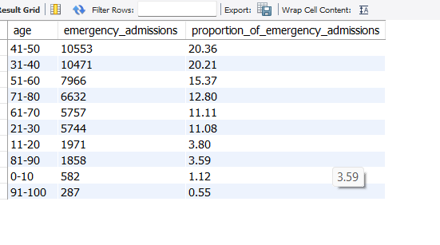
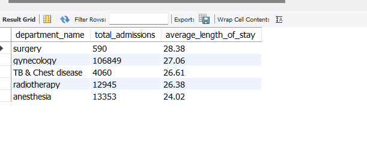
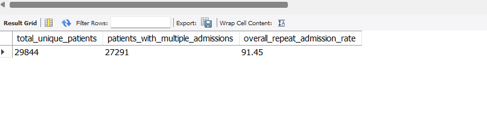
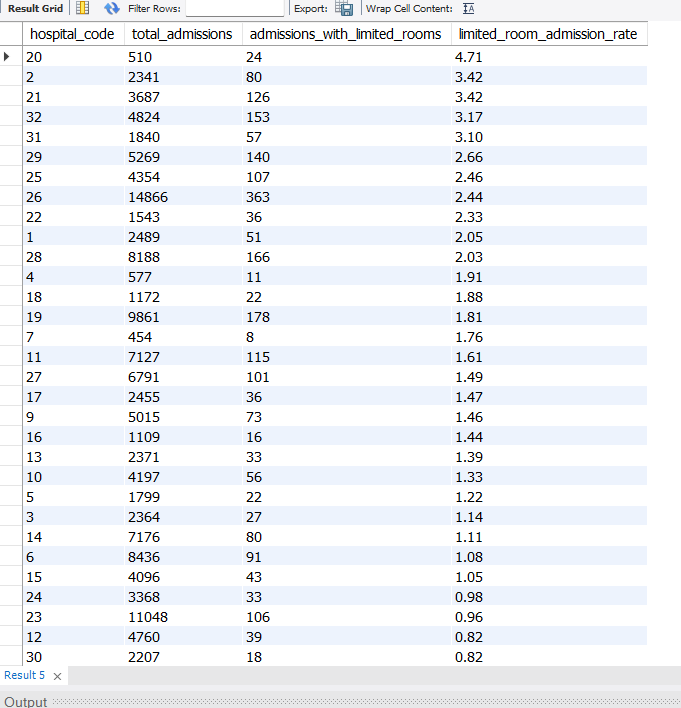

# Hospital Patient Treatment & Analytics Database


A SQL-based hospital analytics project that examines patient admissions, repeat admissions, emergency-department demand, length of stay, and facility bed capacity. The project transforms a healthcare dataset into a normalized MySQL database and a set of operational analyses.

## Project Overview

The repository contains:

- A normalized MySQL database schema
- Four analytical SQL queries
- Four supporting visualization images
- Three Word documents describing business questions, operational methods, and findings
- Repository instructions for obtaining the source dataset

The original source data is not included in this repository. The dataset is an external AV Healthcare Analytics II dataset hosted on Kaggle.

## Business Objectives

This project answers four primary operational questions:

1. Which age groups represent the largest share of emergency admissions?
2. Which departments have the highest average length of stay?
3. What is the overall repeat-admission rate among patients?
4. Which facilities experience the highest proportion of admissions while limited rooms are available?

These questions support resource planning, bed management, departmental capacity planning, and repeat-admission review.

## Repository Structure

```text
hospital-database-patient-treatment-analytics/
├── Analysis_and_insights/
│   ├── ActionableInsights.docx
│   ├── Business question.docx
│   └── operationalexplanation.docx
├── data/
│   └── raw/
│       └── README.md
├── images/
│   ├── Age_groups_with_highest_proportion_of_emergency_admission.png
│   ├── Departments_with_highest_average_length_of_stay.png
│   ├── facility_perfomance_by_bed_occupation_rate.png
│   └── overral_readmissionrate.png
├── sql/
│   ├── analytics/
│   │   ├── Age_group_emergency_admission_proportions.sql
│   │   ├── Departments_with_highest_average_length_of_stay.sql
│   │   ├── facility_perfomance_by_bed_occupation_rate.sql
│   │   └── overral_readmission_rate.sql
│   └── schematic/
│       └── hospital_schema.sql
└── README.md
```

## Data Source

The source dataset is the AV Healthcare Analytics II dataset:

- Kaggle: https://www.kaggle.com/datasets/nehaprabhavalkar/av-healthcare-analytics-ii
- Required source split: `train`
- Original CSV files: not stored in this repository

The analytical queries explicitly filter records using:

```sql
WHERE dataset_source = 'train'
```

This prevents test or other imported records from unintentionally influencing training-based hospital metrics.

## Database Schema

The database dump creates a database-independent schema named `hospital_analysis` and uses MySQL InnoDB tables. The design separates patients, facilities, departments, and admissions into distinct entities.

```text
patients
├── patient_id (primary key)
└── city_code_patient

facilities
├── hospital_code (primary key)
├── hospital_type_code
├── city_code_hospital
└── hospital_region_code

departments
├── department_id (primary key)
└── department_name

admissions
├── case_id (primary key)
├── patient_id → patients.patient_id
├── hospital_code → facilities.hospital_code
├── department_id → departments.department_id
├── age
├── ward_type
├── ward_facility_code
├── bed_grade
├── admission_type
├── severity_of_illness
├── visitors_with_patient
├── available_extra_rooms
├── admission_deposit
├── stay
└── dataset_source
```

### Table Relationships

- Each admission can reference one patient.
- Each admission can reference one facility.
- Each admission can reference one department.
- `patient_id`, `hospital_code`, and `department_id` are indexed in `admissions` for join and filtering performance.

The schema file contains MySQL dump headers, foreign-key settings, table definitions, and InnoDB configuration.

## Analysis and SQL Queries

### 1. Emergency Admissions by Age Group

**Business question:** Which age groups account for the largest proportion of emergency admissions?

```sql
SELECT
    age,
    COUNT(*) AS emergency_admissions,
    ROUND(
        COUNT(*) * 100.0 /
        SUM(COUNT(*)) OVER (),
        2
    ) AS proportion_of_emergency_admissions
FROM admissions
WHERE admission_type = 'Emergency'
    AND dataset_source = 'train'
    AND age IS NOT NULL
GROUP BY age
ORDER BY proportion_of_emergency_admissions DESC;
```

**Method:**

- Filters admission records to emergency admissions from the training dataset.
- Counts admissions by age group.
- Uses a window function to calculate each age group's percentage of all filtered emergency admissions.
- Sorts the result from the highest to lowest emergency-admission proportion.

**Operational use:** Supports shift planning, emergency-capacity planning, and age-focused preparedness without inferring causation.

**Visualization:**

[](images/Age_groups_with_highest_proportion_of_emergency_admission.png)

### 2. Average Length of Stay by Department

**Business question:** Which departments have the highest average length of stay?

```sql
SELECT
    d.department_name,
    COUNT(a.case_id) AS total_admissions,
    ROUND(AVG(a.stay), 2) AS average_length_of_stay
FROM admissions a
JOIN departments d
    ON a.department_id = d.department_id
WHERE a.dataset_source = 'train'
    AND a.stay IS NOT NULL
GROUP BY
    d.department_id,
    d.department_name
ORDER BY
    average_length_of_stay DESC;
```

**Method:**

- Joins admissions to department names.
- Restricts analysis to training records with a recorded stay value.
- Calculates the mean stay length for every department.
- Orders departments by descending average stay.

**Operational use:** Helps identify departments that may require more bed-time, discharge planning, and capacity coordination.

**Visualization:**

[](images/Departments_with_highest_average_length_of_stay.png)

### 3. Repeat-Admission Rate

**Business question:** What percentage of patients have more than one admission?

```sql
SELECT
    COUNT(*) AS total_unique_patients,
    SUM(admission_count > 1) AS patients_with_multiple_admissions,
    ROUND(
        SUM(admission_count > 1) * 100.0 / COUNT(*),
        2
    ) AS overall_repeat_admission_rate
FROM (
    SELECT
        patient_id,
        COUNT(*) AS admission_count
    FROM admissions
    WHERE dataset_source = 'train'
    GROUP BY patient_id
) AS patient_admissions;
```

**Method:**

- Groups admissions by patient identifier.
- Counts each patient's admissions.
- Counts patients with an admission count greater than one.
- Divides repeat-patient count by total unique-patient count.

**Operational use:** Indicates the scale of repeat admissions and provides a baseline for reviewing discharge processes, follow-up pathways, and continuity of care.

**Important interpretation:** The source data only supports an observed repeat-admission rate. The query does not determine whether a repeat visit was preventable or whether it occurred within a defined interval such as 30 days.

**Visualization:**

[](images/overral_readmissionrate.png)

### 4. Facility Pressure by Limited-Room Admissions

**Business question:** Which facilities have the highest proportion of admissions when one or fewer extra rooms are available?

```sql
SELECT
    f.hospital_code,
    COUNT(a.case_id) AS total_admissions,
    SUM(
        CASE
            WHEN a.available_extra_rooms <= 1 THEN 1
            ELSE 0
        END
    ) AS admissions_with_limited_rooms,
    ROUND(
        SUM(
            CASE
                WHEN a.available_extra_rooms <= 1 THEN 1
                ELSE 0
            END
        ) * 100.0 / COUNT(a.case_id),
        2
    ) AS limited_room_admission_rate
FROM admissions a
JOIN facilities f
    ON a.hospital_code = f.hospital_code
WHERE a.dataset_source = 'train'
    AND a.available_extra_rooms IS NOT NULL
GROUP BY f.hospital_code
ORDER BY limited_room_admission_rate DESC;
```

**Method:**

- Joins admissions to facilities.
- Defines limited room availability as `available_extra_rooms <= 1`.
- Counts limited-room admissions and total admissions for each hospital code.
- Calculates the percentage of admissions occurring under the limited-room condition.

**Operational use:** Provides a capacity-pressure indicator that can support bed allocation, overflow planning, and facility-level review.

**Visualization:**

[](images/facility_perfomance_by_bed_occupation_rate.png)

## Operational Workflow

### 1. Acquire the Data

Download the source CSV files from Kaggle and prepare the tables locally. The repository documents the dataset location but does not include or redistribute the raw files.

### 2. Create the Database

Create a MySQL 8.0 database and load the schema:

```sql
CREATE DATABASE hospital_analysis;
USE hospital_analysis;
```

Run:

```bash
mysql -u <username> -p hospital_analysis < sql/schematic/hospital_schema.sql
```

### 3. Load Source Records

Load or import the prepared CSV data into:

- `patients`
- `facilities`
- `departments`
- `admissions`

Ensure that:

- `admissions.case_id` is unique.
- Foreign-key references exist in the three dimension tables.
- `dataset_source` identifies the intended split as `train`.
- Numeric values used in calculations are imported as integers or decimals.

### 4. Run the Analyses

Execute each file from `sql/analytics/` using MySQL Workbench, a MySQL shell, or a compatible SQL client.

```bash
mysql -u <username> -p --database hospital_analysis \
  < sql/analytics/Age_group_emergency_admission_proportions.sql

mysql -u <username> -p --database hospital_analysis \
  < sql/analytics/Departments_with_highest_average_length_of_stay.sql

mysql -u <username> -p --database hospital_analysis \
  < sql/analytics/overral_readmission_rate.sql

mysql -u <username> -p --database hospital_analysis \
  < sql/analytics/facility_perfomance_by_bed_occupation_rate.sql
```

### 5. Validate Results

Before operational use:

- Confirm the source table row counts.
- Confirm whether duplicate patient IDs represent legitimate repeat admissions.
- Verify that `admission_type`, `age`, `stay`, and `available_extra_rooms` contain expected values.
- Test for NULL, invalid, or outlier values.
- Reconcile summarized results against a direct row-level audit.

### 6. Export or Visualize

Export query results to CSV or connect MySQL to a reporting tool. The repository already contains four PNG charts corresponding to the SQL outputs.

## Key Findings

The following figures summarize the reported analysis outputs. Since the source CSV files and exported numeric result tables are not included in this repository, rerun the SQL against the intended source split and validate these figures before using them for operational decisions.

| Business question | Key findings | Main insight |
| --- | --- | --- |
| Which departments have the highest average length of stay? | Surgery recorded the highest average stay value at **28.38**, followed by Gynaecology (**27.06**), TB & Chest Disease (**26.61**), Radiotherapy (**26.38**), and Anaesthesia (**24.02**). Surgery had **590 admissions**, while Gynaecology had the largest admission volume at **106,849**. | Surgery has the highest reported average, but its admission volume is much lower than Gynaecology's. Consider both average stay and volume when prioritizing review. |
| What is the overall repeat-admission rate? | Of **29,844 unique patients**, **27,291** had multiple recorded admissions, resulting in an overall repeat-admission rate of **91.45%**. | This is a patient-level repeat-admission measure across the available records, not a confirmed 30-day readmission rate. |
| Which age groups account for the highest proportion of emergency admissions? | Ages **41–50** accounted for **20.36%**, followed by ages **31–40** at **20.21%**. Ages **51–60** contributed **15.37%**. | Adults aged **31–50** collectively accounted for approximately **40.57%** of emergency admissions, making this the largest contributing age range in the reported results. |
| How does facility performance vary by bed occupancy rate? | Using limited room availability as a proxy, Hospital **20** recorded the highest rate at **4.71%**. Hospitals **2** and **21** each recorded **3.42%**; Hospitals **12** and **30** recorded the lowest rate at **0.82%**. | The metric describes the share of admissions with one or fewer extra rooms available. It indicates a potential capacity-pressure pattern, not actual bed occupancy or overall hospital performance. |

## Operational Implications of the Findings

The findings point to opportunities for hospitals to review operational efficiency, resource allocation, and patient management. They are descriptive signals for further investigation and should not be interpreted as proof of a particular cause.

- **Departmental patient flow:** Surgery had the highest reported average length-of-stay value (**28.38**). Administrators could review patient flow, discharge processes, and departmental resource requirements. Its lower admission count (**590**) compared with Gynaecology (**106,849**) is important context when interpreting the average.
- **Facility capacity pressure:** Hospital **20** had the highest limited-room admission rate (**4.71%**). This may warrant a review of room availability, bed allocation, and local resource planning. The measure is a proxy based on extra rooms available, not a direct bed occupancy rate.
- **Emergency service planning:** Patients aged **31–50** accounted for approximately **40.57%** of emergency admissions in the reported results. Hospitals can consider this pattern when planning emergency staffing, equipment, and service capacity, while also reviewing other age groups and local demand.
- **Repeat-admission monitoring:** The reported **91.45%** rate indicates that many patients had more than one recorded admission in this dataset. It does not establish 30-day readmissions, preventability, or the reason for return; those questions require suitable time intervals and additional clinical context.

Overall, these findings provide administrators with evidence to identify potential operational pressure points, improve resource utilization, and support service planning. Validate the results against current, locally relevant data before making staffing, capacity, or patient-care decisions.

## Actionable Findings for Hospital Administration

1. **Review departmental efficiency:** Investigate patient flow, discharge delays, and resource availability in Surgery, while considering its admission volume and comparing it with other departments.
2. **Assess facility capacity:** Review room availability and resource allocation at Hospital 20 and other facilities with elevated limited-room admission rates. Use bed-capacity and occupancy data to confirm whether the proxy reflects actual capacity constraints.
3. **Plan emergency services around observed demand:** Consider the age distribution of emergency admissions, including the 31–50 age group, when evaluating staffing, equipment, and service capacity.
4. **Define a meaningful readmission measure:** If the goal is to monitor 30-day readmissions, incorporate admission and discharge dates, define the eligible population and interval, and distinguish repeat admissions from readmissions.
5. **Monitor trends routinely:** Recalculate these measures over consistent time periods and review them alongside patient volume, case mix, facility capacity, and data-quality checks.

These actions are intended to guide investigation and planning. The analysis alone does not establish that any single intervention will cause improved outcomes.

## Data Quality and Limitations

- Raw source data is not included in the repository.
- No license is specified for this repository.
- The project has no automated testing or CI workflow.
- The repeat-admission metric is a patient-level count; it does not identify preventable readmissions or admission timing intervals, and is not a 30-day readmission rate.
- The bed-pressure metric is based on `available_extra_rooms <= 1`, not an official hospital occupancy percentage.
- Department length of stay uses `AVG(a.stay)` and assumes the stored `stay` values are numeric or MySQL-convertible.
- SQL logic excludes NULL age and stay values where relevant, but this is not a complete data-quality audit.
- Cross-facility and cross-city comparisons may require normalization by capacity, population, case mix, and time period.
- The available charts contain summarized outputs, but no chart-generation scripts are included.
- The DOCX files are supporting summaries and are not machine-readable project configuration.
- The numerical findings in this README should be checked against rerun query outputs because raw data and reproducible result tables are not included.

## Requirements

- MySQL 8.0 or a compatible MySQL-compatible SQL engine
- MySQL Workbench or MySQL command-line client
- Downloaded AV Healthcare Analytics II source CSV files
- CSV import permissions or an existing import into the four relational tables
- Optional: Excel, Power BI, Tableau, Python, or another reporting tool for visualization

## MySQL Compatibility Notes

The schema uses MySQL-specific features and dump directives:

- `AUTO_INCREMENT` for department IDs
- InnoDB engine configuration
- UTF8MB4 character sets
- Foreign-key constraints
- MySQL dump session directives

The analytical query uses a window function:

```sql
SUM(COUNT(*)) OVER ()
```

This is supported by MySQL 8.0. A non-MySQL engine may require syntax adaptation.

## Security and Privacy

Hospital and patient data may be sensitive. Before using real data:

- Apply minimum-necessary access controls.
- De-identify records before sharing or publishing.
- Encrypt database connections and backups.
- Restrict administrative credentials.
- Follow applicable privacy and healthcare regulations.
- Do not upload patient-identifiable information to public repositories.

## Supporting Documents

- [`Analysis_and_insights/Business question.docx`](Analysis_and_insights/Business%20question.docx) — business questions and analysis scope
- [`Analysis_and_insights/operationalexplanation.docx`](Analysis_and_insights/operationalexplanation.docx) — operational explanation of the project
- [`Analysis_and_insights/ActionableInsights.docx`](Analysis_and_insights/ActionableInsights.docx) — supporting interpretation and recommendations

## Future Improvements

- Add the source CSV schema and a safe import script.
- Add a Docker Compose MySQL environment.
- Add database seed and validation scripts.
- Add chart-generation code.
- Add unit tests for SQL calculations and edge cases.
- Define a formal data dictionary.
- Track data-quality metrics and NULL rates.
- Calculate true readmission intervals instead of lifetime repeat-admission counts.
- Add occupancy metrics using bed capacity and available-room data.
- Add time-period dimensions for trend analysis.
- Add an analysis date, snapshot date, and methodology version.

## Project Status

The repository currently provides:

- A complete MySQL schema dump
- Four executable analytical SQL queries
- Four supporting image outputs
- Three Word-document analysis artifacts
- Data-source and dataset-acquisition guidance

It does not include a complete automated setup pipeline or raw input data.

## Repository

- [View on GitHub](https://github.com/briannjika-cmyk/hospital-database-patient-treatment-analytics)
- Repository ID: `1466307207`
- Default branch: `main`
